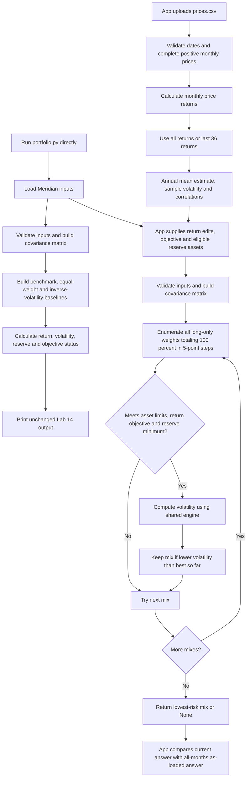

# Lab 15 — Lowest-risk mandate mix

Which mix carries the least risk while meeting the mandate — and does the answer survive a one-point change in one estimate?

## Files and run command

- [Lab 15 README.md](Lab%2015%20README.md): deliverable guide, setup, commands, verification and remaining actions.
- [portfolio.py](portfolio.py): shared engine, grid search and CSV estimator. Existing Lab 14 printed output preserved.
- [app.py](app.py): Streamlit app; imports engine inputs and functions.
- [verify_lab15.py](verify_lab15.py): known answers, CSV fixture checks and actual Streamlit interaction tests.

```powershell
py portfolio.py
py -m streamlit run app.py
```

If Python is available as `python`, replace `py` with `python`.

## Meridian evidence

Objective: expected return at least 6.50%. Hard constraint: reserve-eligible weight at least 3%; bills and the 10-year note count. Training returns are course-authored estimates, not forecasts inferred from prices.

| Run | Bills / 10-year / IG / equity (%) | Return (%) | Volatility (%) | Reserve (%) |
|---|---|---:|---:|---:|
| As loaded | 0 / 20 / 25 / 55 | 6.51 | 9.44 | 20.00 |
| Equity estimate 8% to 7% | 0 / 10 / 10 / 80 | 6.53 | 12.94 | 10.00 |
| IG–equity correlation 0.50 | 0 / 40 / 0 / 60 | 6.52 | 9.73 | 40.00 |

Largest weight change under the one-point return stress: **25 percentage points**, in equity. Estimated volatility rises by 3.50 points. Lower equity return forces a larger equity position to meet the unchanged target because equity still has the highest estimated return.

Automated checks passed for both original Lab 14 scripts and the new Lab 15 checks on October 22, 2026. Streamlit AppTest exercised the equity return box and observed 25.00 points. Changing the imported engine's correlation cells to 0.50 changed the real page's weights as expected; the test restored both cells to 0.25. The correlation propagation check used an in-memory engine change, not a claimed manual browser/file-edit exercise.

The lowest-risk claim is limited to fully invested, long-only portfolios on the 5-point grid and the entered constraints. This is not proof of a continuous optimum or compliance with all Meridian rules, including the unresolved calendar-year loss condition.

## Engine flowchart



The app runs the search twice under the same current objective and reserve rule: once with the edits and selected estimation window, once with untouched loaded return estimates and all-months risk estimates. Largest change is the maximum absolute difference between corresponding weights, in percentage points. If either run is infeasible, the app reports no comparison. A 3% minimum implies at least 5% on the search grid.

## Project 2 universe — EEM confirmed and data analyzed

The student selected **VOO, QQQ, VB and EEM**, confirming EEM as the emerging-markets ETF. The annual expected-return objective is **at least 7%**. Allocation constraints: **VOO at least 40%, VB at most 30%, and EEM at most 30%**. No additional reserve minimum was stated, so Project 2 mode defaults to 0%. These limits apply to fund weights; VB's cap does not measure small-company holdings inside other funds. Weights are long-only and sum to 100%.

The shared search enforces all three limits for both displayed answers. Project 2 mode accepts exactly VOO, QQQ, VB and EEM, and automatically loads the saved prices.csv when no replacement is uploaded. Meridian remains the default training mode. Checks passed for the caps and floor, infeasibility for incompatible minima, Project 2 defaults, both personal windows, the personal one-point edit, and the original Meridian results.

[prices.csv](prices.csv) contains 61 month-end adjusted-close observations from **September 30, 2021 through September 30, 2026**, providing 60 monthly returns over five years. October 2026 is excluded because it is incomplete. Raw daily Yahoo chart responses are retained as TICKER_yahoo_daily.json. For each completed calendar month, the last trading day's adjusted close is selected and labelled with calendar month-end. All four funds share the same selected trading dates; no prices were filled or simulated. The final daily observation in each month is within four days of month-end.

CSV: date first, oldest month first, then one column per ticker. Last 36 means 36 returns from October 2023 through September 2026, requiring 37 prices starting September 2023. Returns are labelled **historical arithmetic estimates, monthly mean × 12**, not forecasts or compound annual growth rates. Volatility uses sample standard deviation × square root of 12. Correlations use the same complete monthly return panel. Historical adjusted prices may be revised by the provider; retain the downloaded snapshot for reproducibility.

| Ticker | Fund / mandate role | Adjusted-close source URL | Actual download date |
|---|---|---|---|
| VOO | Core allocation, minimum 40% | [Yahoo Finance adjusted close](https://finance.yahoo.com/quote/VOO/history/) | 2026-10-22 |
| QQQ | Additional equity allocation | [Yahoo Finance adjusted close](https://finance.yahoo.com/quote/QQQ/history/) | 2026-10-22 |
| VB | Small-cap fund, maximum 30% | [Yahoo Finance adjusted close](https://finance.yahoo.com/quote/VB/history/) | 2026-10-22 |
| EEM | Emerging markets, maximum 30% | [Yahoo Finance adjusted close](https://finance.yahoo.com/quote/EEM/history/) | 2026-10-22 |

Actual retrieval: Yahoo Finance v8 chart endpoint with `range=6y`, `interval=1d`, `events=history`, and `includeAdjustedClose=true`, using `indicators.adjclose`, not the unadjusted close. [project2_results.json](project2_results.json) records each exact download URL, raw-response SHA-256 hash, estimates, correlation matrices, portfolio results and one-point stresses. [prepare_project2.py](prepare_project2.py) rebuilds the CSV and results from the saved raw responses using the shared portfolio engine.

| Fund | Five-year return estimate (%) | Five-year volatility (%) | Last-36 return estimate (%) | Last-36 volatility (%) |
|---|---:|---:|---:|---:|
| VOO | 14.18 | 15.67 | 21.49 | 12.45 |
| QQQ | 17.35 | 20.87 | 26.39 | 17.26 |
| VB | 8.55 | 19.06 | 16.51 | 16.96 |
| EEM | 9.53 | 17.68 | 22.53 | 15.23 |

| Personal run | Weights | Expected return | Volatility | Reserve |
|---|---|---|---|---|
| All months | VOO 70% / QQQ 0% / VB 0% / EEM 30% | 12.78% | 14.99% | 0.00% |
| Last 36 returns | VOO 80% / QQQ 0% / VB 0% / EEM 20% | 21.70% | 12.17% | 0.00% |

Largest personal weight change between windows: **10 percentage points**, in VOO and EEM. Both runs meet the unchanged 7% objective and all three allocation limits. Zero in QQQ and VB is allowed: selecting funds defines what the engine may use, not a requirement to hold every fund.

In an automated sensitivity check, each fund's expected return was reduced by **one percentage point**, one fund at a time, leaving risk inputs and constraints fixed. Every such stress produced **0 percentage points** of allocation change in both windows. The return objective remains slack: even the largest portfolio-return reduction leaves the mix above 7%. The window change also alters volatility and correlations, which explains why it can change weights when the single-return stresses do not. Stability under these stresses does not validate the historically high return estimates or establish resilience to larger changes.

The student's partner concern and decision are recorded below. The student has not reported a numeric change made by the partner in the app, so the automated stresses must not be presented as a completed live partner attack.

## Partner concern, EEM audit and the student's call

The student reports that their partner questioned whether 7% was achievable with the small-cap allocation capped at 30%. The partner also questioned whether the method retrieved the correct EEM values from the website, because they distrusted EEM's estimated return. These are reported concerns, not invented quotations or a claimed numeric app edit.

Two-sentence response based on the reported concern and verified evidence: **The 30% small-cap limit does not prevent the model from meeting 7%: its five-year answer holds no VB and estimates a 12.78% return, although that historical estimate cannot promise future performance. I checked all 61 EEM monthly prices against the saved Yahoo adjusted-close response and independently reproduced its 9.53% arithmetic annual estimate; lowering EEM by one point leaves the weights unchanged at 70% VOO and 30% EEM, with a 12.48% estimated return.**

Audit evidence: [audit_eem.py](audit_eem.py) independently matches every EEM CSV observation to the last trading-day adjusted close for that month in the raw response. It checks the symbol is EEM and currency is USD, and uses Python's statistics functions to independently reproduce monthly-mean annualization and sample volatility. [EEM_data_audit.json](EEM_data_audit.json) records 61 matching prices, 60 returns, a first adjusted price of 44.79319763183594 and final adjusted price of 66.79000091552734. Yahoo's [historical table](https://finance.yahoo.com/quote/EEM/history/) displays September 30, 2026 adjusted close as 66.79, matching the saved endpoint to displayed precision. Yahoo [defines adjusted close](https://in.help.yahoo.com/kb/adjusted-close-sln28256.html) as incorporating applicable splits and dividend distributions. Matching the provider confirms extraction and calculation consistency, not an independent audit of the provider's entire history or a validation of future returns.

EEM's five-year **arithmetic annual estimate is 9.53%**, while its **compound annual growth over the same endpoints is 8.32%**. The last-36 arithmetic estimate is 22.53%, which is a different sample. None is a promised forward return. The 9.53% figure comes from 12 times the mean of 60 monthly returns, not from scraping a displayed website annual performance number.

An additional AI-run diagnostic, not a partner action: setting EEM's return estimate to 0%, while retaining VOO's historical estimate and the same risk inputs, still yields 70% VOO / 30% EEM at 9.92% estimated portfolio return and 14.99% volatility. This shows that the 7% target is not binding under these assumptions; it does not establish that VOO's own estimate is reliable.

**Student decision:** keep the 70% VOO / 30% EEM mix and the existing mandate as the Project 2 starting allocation. The student emphasizes smoothing portfolio volatility rather than pursuing more earning potential and cites the S&P 500's long-run average as their rationale. An average should not be described as an annual result or guarantee, and a portfolio composed entirely of equity funds can still experience large losses.

The student's condition for changing the decision is still needed. Suggested wording for the student to accept or revise: **Adopt as my Project 2 starting allocation, and reassess if updated estimates make the 7% objective infeasible or move any weight by more than the 10-point difference already observed between windows.** This proposed condition is AI-authored and has not been attributed to the student as an accepted statement.

## Estimation risk — AI study notes

Estimation risk is uncertainty in the return, volatility and correlation inputs. Five years of historical observations are a limited sample and may describe a different market regime than the next five years.

The optimizer treats entered estimates as exact. A small change can make its previous best mix infeasible, so it jumps to another feasible grid point. With a binding return target, even a lower estimate for the highest-return asset may require buying more of it. Meridian demonstrates this: a one-point lower equity estimate shifts 25 points into equity. This is sensitivity to uncertain inputs, not evidence of a better forecast.

Before adoption, examine whether estimates have an economic basis, whether the mix is stable under plausible changes and alternate windows, and whether the client can tolerate the resulting exposures and losses.

## Student and partner work — not yet completed

- No-screen universe, objective and constraint exchange; paper engine drawing.
- Explain the search line by line and record the partner's question and your answer.
- Partner concern and two-sentence evidence-based response are recorded above. Still needed for the live partner attack: any actual numeric app edit, its before/after values and resulting allocation; none has been reported.
- Record your own largest weight change and explain why the lowest-risk mix moved.
- Decision to keep the Project 2 starting allocation is recorded above. Student confirmation of a condition for changing that decision remains pending.

AI draft for Meridian discussion only: **Pilot:** lowering the equity estimate one point moves 25 points into equity and raises estimated volatility from 9.44% to 12.94%. Consider adoption only after validating the estimates, checking stability and obtaining CIO clarification of the loss condition. This is not the student's personal-universe call or a claimed partner response.

## GitHub checkout — pending

Publish this Markdown file, portfolio.py, app.py and the sourced personal prices.csv to the intended repository. Repository destination has not been provided; local files and automated checks do not establish GitHub submission or completion of the quiz and partner activities.
